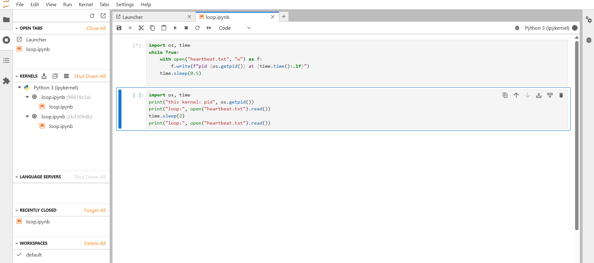

# Fixing Duplicate Kernel Sessions in JupyterLab (Issue #20372)

> Reloading a notebook can reconnect it to the wrong kernel, so **Restart Kernel** no longer stops the code the notebook started.

**Issue:** [jupyterlab/jupyterlab#20372](https://github.com/jupyterlab/jupyterlab/issues/20372)
**Package changed:** `@jupyterlab/apputils` (`packages/apputils`)
**Event:** 2-day open-source contribution sprint

## Team

| Name | Role |
| --- | --- |
| **Sambhram Sattigeri** | Team leader |
| Rahul P | Member |
| Rohith M | Member |
| Rahat Jakati | Member |

---

## Table of Contents

1. [Why we chose this issue](#1-why-we-chose-this-issue)
2. [The problem](#2-the-problem)
3. [Reproducing the bug](#3-reproducing-the-bug)
4. [Root cause](#4-root-cause)
5. [Options we considered](#5-options-we-considered)
6. [Our fix](#6-our-fix)
7. [Tests](#7-tests)
8. [Verification](#8-verification)
9. [Behavior change and known limits](#9-behavior-change-and-known-limits)
10. [Project timeline](#10-project-timeline)
11. [Running it yourself](#11-running-it-yourself)
12. [Demo media](#12-demo-media)

---

## 1. Why we chose this issue

- **Familiarity.** We have used JupyterLab in labs and in class for Python modularization, so we already knew the product from a user's side.
- **A real, confirmed bug.** The issue was opened by [@krassowski](https://github.com/krassowski), a JupyterLab maintainer and an active contributor to the codebase. It carries the `bug` label and was triaged by a maintainer (the `status:Needs Triage` label was removed).
- **Well scoped.** The report includes exact reproduction steps, the affected versions, links to the offending lines, and a suggested direction for the fix.
- **Core infrastructure.** `SessionContext` is shared by notebooks, consoles and file editors, so a fix here matters beyond one feature.

## 2. The problem

When a notebook is opened with **Open With → Notebook (no kernel)** while a kernel for it is already running, and a kernel is then selected, JupyterLab starts a **second server session** on the same notebook path.

After a page reload, the notebook connects to the **older** session (the server lists sessions in creation order). The result:

- **Restart Kernel** restarts a different kernel than the one running the user's code.
- The original code keeps running, for example a runaway loop that keeps writing files.
- The toolbar still shows the same kernel name, so nothing signals the switch. Only the running-sessions count in the status bar changes (2 instead of 1).

The bug is a regression: **4.5.11 is unaffected, 4.6.x is affected**.

**Severity:** moderate. There is no crash and no data loss, but the failure is silent and misleading, and it undermines the "one notebook, one session" assumption behind Restart Kernel, kernel status and the Running panel.

## 3. Reproducing the bug

We reproduced the issue locally before changing any code. Steps (from the issue):

1. Create `loop.ipynb` with two code cells:

   ```python
   import os, time
   while True:
       with open("heartbeat.txt", "w") as f:
           f.write(f"pid {os.getpid()} at {time.time():.1f}")
       time.sleep(0.5)
   ```

   ```python
   import os, time
   print("this kernel: pid", os.getpid())
   print("loop:", open("heartbeat.txt").read())
   time.sleep(2)
   print("loop:", open("heartbeat.txt").read())
   ```

2. Open `loop.ipynb`, wait for the kernel to show **Idle**, then close the notebook tab. The kernel keeps running.
3. In the file browser, right-click `loop.ipynb` and choose **Open With → Notebook (no kernel)**.
4. Click **No Kernel** in the toolbar, keep **Python 3 (ipykernel)**, and click **Select**.
5. Run the first cell (the loop).
6. Reload the page.
7. Restart the kernel from the toolbar and confirm.
8. Run the second cell.

**Buggy result:** the second cell shows the loop is still running in a *different* process from the notebook's kernel.

```
this kernel: pid 839814
loop: pid 839629 at 1793698558.6
loop: pid 839629 at 1793698560.6
```

**Expected:** after reload the notebook uses the same kernel as before, and Restart Kernel stops the loop.

### Our reproduction

We reproduced this on our own machine. The screenshot below was taken right after step 5 and the reload. The loop cell is still busy (`[*]`), yet the **Kernels** panel on the left lists **two** kernels for the same `loop.ipynb` (`98618c3a` and `2b3309db`). This is the duplicate session: one notebook, two kernels, and the toolbar still shows a single "Python 3 (ipykernel)".



🎥 Full screen recording of the reproduction (about 80 seconds): [docs/media/bug-reproduction.mp4](docs/media/bug-reproduction.mp4)

[](docs/media/bug-reproduction.mp4)

The original, full-quality recording is in our [Google Drive folder](https://drive.google.com/drive/folders/1eDxs0VYv8Bpk513SW8bP1jB5QzrRf4kL).

## 4. Root cause

Three pieces of code combine to cause the bug (all in `packages/`):

| Location | What it does | Role in the bug |
| --- | --- | --- |
| `notebook-extension/src/index.ts` | The "Notebook (no kernel)" menu item passes `shouldStart: false, shouldReuse: false` | The context deliberately does not connect to an existing session |
| `apputils/src/sessioncontext.tsx` → `changeKernel()` / `_changeKernel()` | Only reuses `this._session`; with none, it calls `sessionManager.startNew()` | Creates a **second** session on the same path |
| `apputils/src/sessioncontext.tsx` → `_initialize()` | After reload, connects to the first session the server lists for the path | Picks the **older** session, so the notebook silently switches kernels |

## 5. Options we considered

| Option | Idea | Fixes the cause? | Keeps #18856? | Size | Main risk |
| --- | --- | :---: | :---: | --- | --- |
| **A (chosen)** | Attach to the existing session, then change its kernel | Yes | Yes | ~20 lines | Replaces a same-name kernel, losing running state |
| **B** | A, but leave the kernel alone if the names match | Yes | Yes | A bit more than A | Changes what **Select** means (a product decision) |
| **C** | Make reload pick a session by rule (newest, active) | No | Yes | Medium | Duplicates remain; any rule can guess wrong |
| **D** | Remove `shouldReuse: false` from the menu item | No | No | One line | Undoes PR #18856, a deliberate feature |

**Why A:** it fixes the bug where it happens (at creation time), reuses code that already exists, and keeps the "Notebook (no kernel)" feature working as designed. B is our fallback if the maintainers want it. C could be a later safety net. D was rejected because it trades one bug for another.

## 6. Our fix

**File:** `packages/apputils/src/sessioncontext.tsx` (+40 / −3)

We added a private helper that looks for an existing session on the notebook's path before the kernel is changed:

```ts
/** Connect to the session on the current path, if there is one. */
private async _connectToPathSession(): Promise<void> {
  if (this._session) { return; }
  const manager = this.sessionManager;
  try {
    await manager.refreshRunning();
  } catch (err) {
    console.warn('Could not refresh the running sessions.', err);
    return;
  }
  const model = find(manager.running(), item => item.path === this._path);
  // The state may have changed while the sessions were refreshed.
  if (!model || this._session || this.isDisposed) { return; }
  try {
    this._handleNewSession(manager.connectTo({ model }));
  } catch (err) {
    void this._handleSessionError(err as ServerConnection.ResponseError);
    throw err;
  }
}

async changeKernel(options = {}) {
  if (this.isDisposed) { throw new Error('Disposed'); }
  await this._initStarted.promise;
  await this._connectToPathSession(); // new
  return this._changeKernel(options);
}
```

`_changeKernel()` is unchanged. Once the context is attached to the existing session, it takes its existing "we already have a session, just change the kernel" branch.

### What it guarantees

- **One session per path.** No duplicate is created, so after reload the notebook reconnects to the same kernel and Restart Kernel stops the code the notebook started.
- **Concurrency-safe.** `this._session` and `isDisposed` are re-checked after the `await`, so two simultaneous requests cannot both connect.
- **Fresh data.** The session list is refreshed first, so a session missing from the cache is still found.
- **Graceful failure.** A refresh failure logs a warning and falls back to starting a new session. A `connectTo` error goes through the existing error dialog.
- **Existing behavior intact.** `_initialize()` still honors `shouldReuse: false`, so "Notebook (no kernel)" still opens with no kernel until one is picked.

## 7. Tests

**File:** `packages/apputils/test/sessioncontext.spec.ts` (+193 / −3). Before this change, no test covered a session already existing on the path while the context had none, which is why the bug was not caught in CI.

Shared helpers:

- `initializeWithoutKernel()` sets `shouldStart: false, shouldReuse: false` (the "Notebook (no kernel)" state).
- `sessionsOnPath()` refreshes the session list and returns only sessions on the test path. Counting sessions this way is what detects the duplicate.

### New tests in `#changeKernel()` (9)

| # | Test | Why it matters |
| --- | --- | --- |
| 1 | Changes the kernel of an existing session on the path | The issue itself: the old code made a second session |
| 2 | Keeps the kernel when it is the existing session's own | Selecting the same kernel creates no new session or kernel |
| 3 | Finds a session not in the cached list | Proves the list is refreshed, not trusted stale |
| 4 | Uses one session for concurrent requests | Guards the concurrency requirement |
| 5 | Starts a session if none exists on the path | The fallback to the old "start new" path still works |
| 6 | Does not reuse a session on a different path | The fix cannot hijack another notebook's session |
| 7 | A context created afterwards connects to the new kernel | The issue's reload scenario |
| 8 | Handles an error when connecting to the path session | Error dialog shown, no half-connected state |
| 9 | Still starts a kernel if running sessions cannot be refreshed | A network blip degrades to the old behavior |

### New test in `#initialize()` (1)

- **Keeps no kernel when `shouldReuse` is false even if a path session exists.** Protects the existing "Notebook (no kernel)" behavior.

Tests 1, 2, 3, 4, 7 and 8 should fail on the old code. Tests 5, 6, 9 and the `#initialize()` test guard behavior that must not change, so they pass on both versions.

## 8. Verification

We verified the fix at four levels: automated tests, static checks, a build, and a manual run in the browser.

### Completed

| Check | Result |
| --- | --- |
| Jest suite for `sessioncontext.spec.ts` | **59/59 passing**, including 12 `#changeKernel()` tests |
| TypeScript compile (`tsc`) | Clean |
| ESLint and Prettier | Clean |
| Dev build | Compiled and launched |
| Manual browser run (same steps as the issue) | **One session** for `loop.ipynb`, and the loop **stopped** after Restart Kernel |

### Still open, and why each one matters

**1. Kernel id unchanged across the reload.**
The manual run showed one session and a stopped loop, but we did not compare kernel ids before and after the reload. The issue's own evidence was the id (`ef404083` before, `57c88b43` after). With the fix, the id seen after reload should match the id seen before it. To check: after step 4 (Select), note the kernel id in the Running panel (or the video's id box), reload, and confirm the same id appears. Automated test 7 checks this in Jest, but not in a real browser.

**2. The new tests fail without the fix.**
A regression test is only useful if it fails on the broken code. We reasoned that tests 1, 2, 3, 4, 7 and 8 would fail on the old code, but we have not run it. To check, temporarily remove only the fix and run the suite, then restore it:

```bash
cd ~/Desktop/jupyterlab
git stash push -- packages/apputils/src/sessioncontext.tsx   # temporarily remove only the fix
cd packages/apputils && jlpm jest test/sessioncontext.spec.ts 2>&1 | grep -E "✕|Tests:"
cd ../.. && git stash pop                                     # restore the fix
```

Expected: failures in tests 1, 2, 3, 4, 7 and 8. Tests 5, 6, 9 and the `#initialize()` test should pass either way. If any of the first group pass without the fix, that test is not catching the bug and needs rework. Always run `git stash pop` before committing.

- [ ] Kernel id confirmed unchanged across reload in the browser
- [ ] New tests confirmed failing on the old code

## 9. Behavior change and known limits

- **Behavior change to disclose:** `changeKernel()` now reuses a path session even when `shouldReuse` is false. A caller that relies on `changeKernel()` always creating a fresh session will behave differently.
- **Same-name kernel is replaced.** Picking the kernel that is already running replaces it with a fresh one, so running state is lost. Option B would avoid this, but it is a product decision for the maintainers.
- **Existing duplicates are not cleaned up.** If several sessions already exist on a path, the first listed is used. The fix only prevents new duplicates.
- **Narrow race.** A `startNew` that finishes while `_connectToPathSession` connects to the same server session is not covered. An optional hardening (`this._session.id !== session.id` in `_changeKernel`) addresses it, but we have not confirmed the race in practice.

## 10. Project timeline

### Day 1: choosing the problem and understanding the bug

1. **Shortlisted repositories.** The competition offered 12 repositories (including pytest, SymPy, Ruff and Biome). We looked through the Biome issue list and the JupyterLab issue lists (`good first issue`, `bug`, `enhancement`).
2. **Picked JupyterLab.** We had used it in labs and class, so we could understand and run it quickly. Our brief was one issue that is real, big enough to matter, and solvable in two days.
3. **Shortlisted issues.** We narrowed it to #18149, #20377 and #18422, read their threads, and drafted comments to confirm the approach with maintainers on #18149 and #20377.
4. **Chose #20372.** It is a confirmed bug (`bug` label, triaged), reported by a maintainer who actively changes this code, with clear steps and pointers to the guilty lines. This met the competition's checks that the issue is real and a maintainer has engaged with it.
5. **Reproduced it locally.** We built the loop notebook, followed the issue's steps, and captured a screenshot (two kernels for one notebook) and a screen recording.
6. **Traced the cause.** We located the three pieces of code involved: the "Notebook (no kernel)" menu item (`shouldReuse: false`), `changeKernel()` / `_changeKernel()` calling `startNew()`, and `_initialize()` picking the first listed session after reload.
7. **Compared fixes.** We weighed options A to D, chose A, and kept B as a fallback for the maintainers.

### Day 2: implementing, testing and verifying

1. **`packages/apputils/src/sessioncontext.tsx` (+40 / −3).**
   - Added the private helper `_connectToPathSession()`: refresh the running sessions, find one whose path matches the notebook, and connect to it.
   - Called it from `changeKernel()` before `_changeKernel()`, so the existing "change the kernel of the current session" branch handles the rest.
   - Re-checked `this._session` and `isDisposed` after the async refresh to prevent concurrent double connections.
   - Added a fallback for refresh failures (log a warning, then start a new session) and routed `connectTo` errors to the existing error dialog.
   - Updated the doc comment on `changeKernel()`.
2. **`packages/apputils/test/sessioncontext.spec.ts` (+193 / −3).**
   - Added two helpers, `initializeWithoutKernel()` and `sessionsOnPath()`.
   - Added 9 tests in `#changeKernel()` and 1 in `#initialize()` (see [Tests](#7-tests)).
   - Added imports for `ServerConnection`, `SessionAPI` and the `Session` type.
3. **Ran the checks.** Jest 59/59, `tsc`, ESLint and Prettier, then a dev build.
4. **Re-ran the reproduction in the browser.** One session on the path, and the loop stopped after Restart Kernel.
5. **Documented everything.** We wrote up the code changes, the options comparison and this README.

### Next steps

- Close the two open verification items in [section 8](#8-verification).
- Open the pull request against `jupyterlab/jupyterlab` referencing #20372, and disclose the behavior change from [section 9](#9-behavior-change-and-known-limits).

## 11. Running it yourself

```bash
# Clone and set up a JupyterLab dev environment
git clone https://github.com/jupyterlab/jupyterlab.git
cd jupyterlab
pip install -e ".[dev,test]"
jlpm install
jlpm build

# Run the tests for the changed package
cd packages/apputils
jlpm jest test/sessioncontext.spec.ts

# Launch JupyterLab from source to follow the reproduction steps
cd ../..
jupyter lab --dev-mode --extensions-in-dev-mode
```

## 12. Demo media

| File | What it shows |
| --- | --- |
| [`docs/media/bug-reproduction.mp4`](docs/media/bug-reproduction.mp4) | Screen recording (about 80 s) of the bug being reproduced locally |
| [`docs/media/before-two-kernels.png`](docs/media/before-two-kernels.png) | Two kernels listed for one `loop.ipynb` while the loop is running |


[](docs/media/bug-reproduction.mp4)

Full-quality originals: [Google Drive folder](https://drive.google.com/drive/folders/1eDxs0VYv8Bpk513SW8bP1jB5QzrRf4kL)

---

## References

- Issue: [#20372](https://github.com/jupyterlab/jupyterlab/issues/20372)
- Related issues: #20369, #20375
- Feature that exposed the bug: PR #18856 ("Notebook (no kernel)")